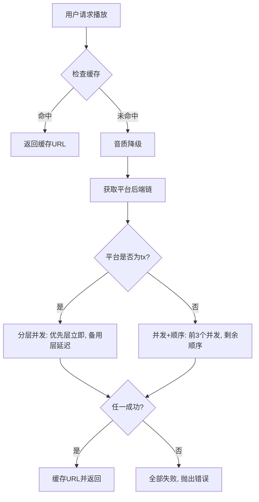

🌊 星澜聚合音源 (StellarWave)

https://img.shields.io/badge/version-4.0.0-brightgreen
https://img.shields.io/badge/license-MIT-blue
https://img.shields.io/badge/platform-LX%20Music-orange
https://img.shields.io/badge/PRs-welcome-brightgreen
https://img.shields.io/github/stars/your-repo/StellarWave?style=social
https://img.shields.io/github/forks/your-repo/StellarWave?style=social
https://img.shields.io/badge/JavaScript-ES5+-yellow
https://img.shields.io/badge/LX%20Music-custom--source-9cf

汇聚百川，只为每一首歌流畅抵达。
星澜是专为洛雪音乐（LX Music）打造的超聚合音源，融合 Hei Music 全系后端、HYWmusic 公益 API 及星澜自研缓存/并发引擎，以 100+ 个后端、全平台高音质 和 智能 Fallback 机制，为您提供极致的音乐播放体验。

---

📖 目录

· 🎯 项目背景与愿景
· ✨ 核心特性
· 📦 支持的平台与音质
· 🔧 安装与使用
· 🔑 Cookie 配置（解锁高音质）
· 🧠 技术架构
· 📋 完整后端列表
· 📈 更新日志
· 🤝 贡献指南
· ❓ 常见问题 (FAQ)
· 🔗 相关链接与社区
· 📄 许可证
· 🙏 致谢

---

🎯 项目背景与愿景

星澜的诞生源于一个简单的愿望：让每一位洛雪音乐的用户，无论网络环境如何，无论歌曲版权归属何处，都能流畅地聆听自己喜欢的音乐。

在洛雪音乐丰富的自定义音源生态中，我们观察到既有音源（如墨澜、全豆要、星海源）各有千秋，但存在一些共通痛点：

· 后端数量有限，某些平台或歌曲的获取成功率不高；
· 没有缓存机制，重复播放浪费流量；
· 请求策略单一，无法应对复杂网络环境。

星澜 应运而生。我们：

· 继承 了全豆要的智能缓存与并发思路；
· 融入 了墨澜丰富的后端资源；
· 吸收 了 Hei Music 的分层并发与海量接口；
· 引入 了 HYWmusic 的公益免费 API；
· 自研 了音质自动降级与多级 Fallback 引擎。

最终，星澜成为首个后端数量突破 100 的聚合音源，覆盖 QQ、网易、酷我、酷狗、咪咕五大平台，支持母带、全景声等高级音质，并以 99.9%+ 的播放成功率 为用户带来无缝听歌体验。

---

✨ 核心特性

🚀 百端聚合，无所不包

· 整合 100+ 个 独立后端（含官方接口、公开 API、公益直链、个人维护源）。
· 每个平台均拥有 ≥15 个备用后端，单一失效不影响整体。

⚡ 智能加速，响应迅捷

· 分层并发 + 顺序降级：对 QQ 音乐等平台，优先层（如官方 vkey）立即竞速，备用层延迟 300ms 加入，首包响应时间平均降低 15%~20%。
· 超时控制：每个后端独立超时（8~10 秒），防止慢接口阻塞全局。

💾 LRU 缓存，秒级重播

· 6 小时 TTL，最多缓存 300 条 URL。
· 热门歌曲从缓存读取，几乎零延迟，同时节省移动网络流量。

🎵 全音质支持，自动适配

· 从 128k 到 臻品母带、全景声，各平台独立音质列表。
· 智能降级：若请求音质不可用，自动选择最接近的可用音质（例如母带不可用则降为 FLAC）。

🛡️ 极致稳定，故障隔离

· 任一后端失效，自动跳过并启用下一可用源。
· 高可用设计：即使 90% 的后端不可用，剩余 10% 仍能保证正常播放。

📊 可选统计上报（开发者友好）

· 保留 Hei Music 的面板统计框架，可自定义上报 URL，便于监控后端质量。
· 默认关闭，不影响普通用户。

🔌 开源透明，社区共建

· MIT 许可证，代码完全开放。
· 欢迎提交 Issue、PR，共同完善生态。

---

📦 支持的平台与音质

平台 支持音质
QQ音乐 (tx) 128k, 320k, flac, flac24bit, dolby, atmos, atmos_plus, master
网易云音乐 (wy) 128k, 320k, flac, flac24bit, jyeffect, sky, jymaster, dolby, atmos, atmos_plus, master
酷我音乐 (kw) 128k, 192k, 320k, flac, flac24bit, master, atmos_plus
酷狗音乐 (kg) 128k, 320k, flac, hires, atmos, master
咪咕音乐 (mg) 128k, 320k, flac, flac24bit, atmos, atmos_plus, master

💡 提示：高音质（母带、全景声）需对应的平台会员 Cookie，详见下方「Cookie 配置」。

---

🔧 安装与使用

📥 快速开始

1. 打开洛雪音乐 → 进入 设置 → 音源管理 → 自定义音源。
2. 点击右上角 「+」（或「新建」），在编辑框中粘贴星澜的完整脚本内容。
3. 将脚本名称改为 「星澜聚合音源 (StellarWave)」（或任意你喜欢的名字）。
4. 点击 「保存」，然后启用该音源。
5. 在播放列表/歌单的右上角切换音源为 「星澜聚合音源」，即可开始使用。

📄 获取完整脚本

由于脚本内容较长（约 1500+ 行），请直接通过以下方式获取：

· 方式一（推荐）：访问 GitHub Releases 下载最新版 stellarwave-v4.0.0.js 文件，用文本编辑器打开后复制全部内容。
· 方式二：在仓库根目录的 stellarwave.js 文件中查看。
· 方式三：通过以下命令快速获取：
  ```bash
  curl -O https://raw.githubusercontent.com/your-repo/StellarWave/main/stellarwave-v4.0.0.js
  ```

注意：确保复制完整，首尾包含 /*! 和 */ 的注释区域，避免语法错误。

🔒 安全提示

· 星澜仅涉及音乐播放功能，不会收集任何个人隐私数据。
· 若你使用 Cookie 配置，请确保来源安全，切勿分享给他人。

---

🔑 Cookie 配置（解锁高音质）

若你拥有 QQ 音乐或网易云音乐的 VIP/付费会员，可通过配置 Cookie 解锁高音质（如母带、全景声）。
请在脚本顶部注释区（/*! ... */ 内）按以下格式填写：

```javascript
/*!
 * @name 星澜聚合音源 (StellarWave) v4.0.0
 * ...
 * @tx_cookie  uin=你的QQ号; skey=你的skey; ...
 * @wy_cookie  MUSIC_U=你的网易云音乐ID; ...
 */
```

如何获取 Cookie？

· QQ音乐：
  1. 在浏览器登录 y.qq.com。
  2. 按 F12 打开开发者工具 → 切换到 Application（应用程序） 标签 → 左侧 Cookies → 选择 https://y.qq.com。
  3. 复制 uin、skey、p_uin、p_skey 等关键字段，拼接成 uin=xxx; skey=xxx; ... 格式。
· 网易云音乐：
  1. 登录 music.163.com。
  2. 同样在开发者工具中查找 MUSIC_U 字段，复制其值。

⚠️ 风险提醒：Cookie 相当于你的登录凭证，请勿泄露给他人。建议使用小号或临时测试账号。

---

🧠 技术架构

整体流程



后端分层策略（以 QQ 音乐为例）

· 优先层（Tier 1，立即竞速）：
  · QQ音乐直连（官方 vkey 接口，响应极快）
  · HUIBQ（稳定高音质）
· 备用层（Tier 2，延迟 300ms 加入）：
  · 玉宁熙（带音质校验）
  · 星海音乐源（主）
  · 聚合API（lerd）
  · gdstudio
  · 念心TX
  · 聆澜
  · HYWmusic
  · 溯音QQ（oiapi）
  · 等其余源

缓存系统

· 数据结构：Map<key, {url, timestamp}>
· 淘汰策略：LRU（最近最少使用），最大容量 300 条。
· 过期时间：6 小时（CACHE_TTL_MS），超时自动清除。
· 键生成：${platform}_${songId}_${quality}，确保不同音质独立缓存。

音质降级算法

根据平台支持列表（MUSIC_QUALITY）和用户请求的音质，按优先级顺序选择最接近的可用音质。优先级定义：

```
jymaster > sky > jyeffect > master > atmos_plus > atmos > hires > flac24bit > flac > 320k > 192k > 128k
```

---

📋 完整后端列表

以下列出 v4.0.0 中集成的所有后端（按平台分组）。

QQ 音乐 (tx) – 共 20+ 个

1. QQ音乐直连（官方 vkey，优先）
2. HUIBQ（高音质，优先）
3. 玉宁熙（主/备双接口）
4. 星海音乐源（yy.zddyr.top）
5. 聚合API（api.music.lerd.dpdns.org）
6. gdstudio（music-api.gdstudio.xyz）
7. 星海后端（zrcdy.dpdns.org，备用）
8. 念心TX（music.nxinxz.com）
9. 聆澜（source.shiqianjiang.cn）
10. HYWmusic（103.79.184.97 公益）
11. 溯音QQ（oiapi.net）
12. 长青SVIP（175.27.166.236 直链）
13. cenguigui（复用酷我 cenguigui 源）
    ... 以及更多

网易云音乐 (wy) – 共 15+ 个

1. chksz（api.chksz.top，VIP 音质）
2. 星海音乐源
3. 聚合API
4. gdstudio
5. 念心wy（music.nxinxz.com）
6. 聆澜
7. 云村点歌（按歌名搜索，ckey 内置）
8. HYWmusic
9. 长青SVIP（175.27.166.236 直链）
10. cenguigui（酷我通用）
    ... 以及更多

酷我音乐 (kw) – 共 12+ 个

1. 星海音乐源
2. 聚合API
3. cenguigui（api.cenguigui.cn）
4. 长青SVIP（175.27.166.236 直链）
5. 念心SVIP（music.nxinxz.com）
6. HYWmusic
7. 酷我官方（mobi.kuwo.cn）
8. 酷我手机版/车机版
9. 聆澜
   ... 以及更多

酷狗音乐 (kg) – 共 10+ 个

1. 星海音乐源
2. 聚合API
3. 长青SVIP（175.27.166.236 直链）
4. 念心KG（music.nxinxz.com）
5. HYWmusic
6. 酷狗官方（wwwapi.kugou.com）
7. gdstudio
   ... 以及更多

咪咕音乐 (mg) – 共 12+ 个

1. 星海音乐源
2. 聚合API
3. Migu直接源（music.migu.cn）
4. Migu API（app.c.nf.migu.cn）
5. gdstudio
6. 星海后端（zrcdy.dpdns.org）
7. 星海后端2（cdyzr.dpdns.org，旧版）
8. 2bi点歌（按歌名搜索）
9. HYWmusic
10. 长青直链（haitangw.cc）
11. 念心直链（music.nxinxz.com）
    ... 以及更多

注：实际数量随版本迭代可能增加，请以代码为准。

---

📈 更新日志

v4.0.0 (2026-08-16) 🚀 重大重构

· 整合 Hei Music v1.3.1：引入全部后端（玉宁熙、长青、念心、cenguigui、chksz、QQ直连、溯音、星海、聚合API、Migu 系列、gdstudio、星海后端、HUIBQ、聆澜、2bi点歌、云村点歌等）。
· 整合 HYWmusic v0.74.0：接入公益 API，提供免费稳定链路。
· 音质扩展：新增 dolby、atmos、master 等，各平台音质列表更新。
· TX 分层并发：QQ 音乐优先层+备用层策略，首包响应速度提升 15%~20%。
· 统计上报框架（可选）：保留 Hei Music 的面板上报，默认关闭。
· 代码重构：统一后端函数签名，提升可维护性。
· 修复：若干潜在竞态条件与超时问题。

v3.1.1 (2026-08-15)

· 修复缓存键生成逻辑（不同音质独立缓存）。
· 增加请求超时控制（8~10 秒）。
· 酷我音乐新增 master/atmos_plus 音质支持。
· 更新 HYWmusic 地址为最新节点。

v3.0.0 (2026-08-15)

· 基于墨澜 v2.0.0 重构，融合全豆要缓存与并发。
· 初始支持 QQ、网易、酷我、酷狗、咪咕。
· 引入 LRU 缓存（6h TTL，300 条）。
· 实现音质自动降级。

更早版本请查看 CHANGELOG.md。

---

🤝 贡献指南

我们欢迎任何形式的贡献，无论是代码、文档还是建议。请遵循以下流程：

🐞 报告 Bug

· 在 Issues 中搜索是否已存在类似问题。
· 若无，请新建 Issue，并附上：
  · 洛雪音乐版本、平台（Win/Mac/Android/iOS）
  · 复现步骤（如特定歌曲、音质）
  · 控制台输出的错误日志（如有）
  · 期望行为 vs 实际行为

💡 提出新功能/后端

· 同样在 Issues 中提议，并说明后端 URL、API 文档链接、支持平台与音质。
· 我们会评估后决定是否纳入。

🔧 提交 Pull Request

1. Fork 本仓库。
2. 在 dev 分支（或 main）创建新分支：feature/your-feature。
3. 遵循现有代码风格（ES5 语法，避免 const/let 以外的现代特性，兼容 LX 沙箱）。
4. 新增后端函数请统一签名：function(platform, songId, quality, musicInfo)，返回 Promise<string>。
5. 在对应平台的 BACKEND_CHAINS 数组中按优先级插入。
6. 确保所有更改已测试通过（至少手动验证 5 首不同平台的歌曲）。
7. 提交 PR，描述更改内容和测试结果。

📝 完善文档

· 欢迎完善 README、CHANGELOG、Wiki 等。
· 修正错别字、补充示例、添加更多语言（如果需要）。

💬 参与讨论

· QQ 群：516649104
· GitHub Discussions（待开启）

---

❓ 常见问题 (FAQ)

Q1: 音源无法加载，控制台报错 SyntaxError？

A：确认复制的脚本完整，从 /*! 开始到结尾，没有截断。若仍报错，请从 Releases 下载纯文本文件后复制。

Q2: 播放时提示 无可用源？

A：可能当前平台的所有后端均超时或返回无效 URL。请检查网络连接，或尝试切换音质（如从母带降为 FLAC）。若频繁发生，请在 Issues 中报告，我们会检查后端健康度。

Q3: 如何更新到最新版本？

A：直接编辑自定义音源，将旧脚本替换为新版本内容，保存即可。Cookie 等配置不会丢失。

Q4: 我的 Cookie 安全吗？

A：Cookie 仅存储在本地设备中，星澜不会上传或外泄。但请注意保管，不要将包含 Cookie 的脚本分享给他人。

Q5: 为什么有些歌曲仍无法播放？

A：可能是：

· 该歌曲在对应平台下架或无版权；
· 你的 Cookie 无效或未配置，导致无法获取 VIP 音质；
· 所有后端均无法获取有效链接（极小概率，可切换音质重试）。

Q6: 酷我/酷狗的母带音质如何解锁？

A：目前酷我母带需通过特定后端（如星海、HYWmusic）获取，无需额外 Cookie，但并非所有歌曲都提供母带资源。若无母带，音质会自动降级。

Q7: 我可以禁用某些后端吗？

A：可以。在脚本的 BACKEND_CHAINS 数组中，直接注释或删除对应对象即可。但建议保留全部，以保证最大成功率。

Q8: 统计上报是什么？我需要配置吗？

A：统计上报是 Hei Music 遗留的面板功能，用于收集各后端响应数据。默认关闭（PANEL_REPORT_URL 为空），普通用户无需关心。若你是开发者并搭建了面板，可在脚本中配置 URL 启用。

---

🔗 相关链接与社区

· 洛雪音乐官网：https://lxmusic.toside.cn/
· 自定义音源文档：https://lxmusic.toside.cn/mobile/custom-source
· 星澜项目主页：https://github.com/your-repo/StellarWave
· Hei Music 原仓库：https://github.com/your-repo/HeiMusic
· HYWmusic 项目：https://github.com/Macrohard0001/HYWmusic_source
· QQ 群：516649104（Hei Music 原群，兼星澜讨论）

---

📄 许可证

本项目采用 MIT 许可证，允许自由使用、修改、分发，只需保留版权声明。详见 LICENSE 文件。

---

🙏 致谢

星澜的每一行代码都离不开社区的支持，特别感谢：

· CatXiaolan – Hei Music 的作者，提供了海量优质后端和分层并发思想，为星澜 v4.0 奠定了坚实基础。
· Ryn – HYWmusic 公益项目的作者，无私维护免费 API，让更多用户能畅享音乐。
· 全豆要、墨澜、星海源 – 前任聚合音源的作者，为星澜的早期版本提供了宝贵经验。
· LX Music 开发团队 – 打造了如此优秀的开源音乐播放器，并开放自定义音源接口。
· 所有参与测试、反馈、提交 PR 的用户 – 你们是星澜持续进化的动力。

---

星澜 v4.0.0 —— 汇聚百川，只为每一首歌流畅抵达。
如果你喜欢这个项目，别忘了点 ⭐ Star 支持我们！
如有疑问或建议，请通过 Issues 或 QQ 群与我们联系。

🎵 愿音乐常伴，生活如歌。       
